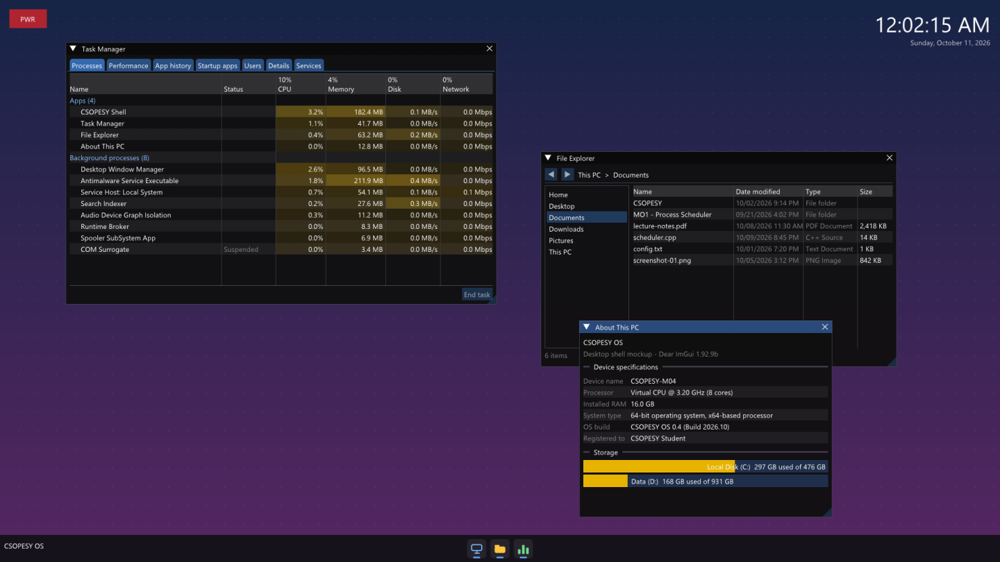

<div align="center">

# CSOPESY OS

**CSOPESY MO4: a desktop-style OS mock-up built with Dear ImGui**


[Features](#features) • [Getting started](#getting-started) • [Make targets](#make-targets) • [Project structure](#project-structure)



</div>

Windows, macOS and Android all have a compositor that draws the desktop and manages windows every frame. CSOPESY OS has its own compositor too, built on **GLFW + OpenGL 3 + Dear ImGui**. It isn't a working OS. It's a real-time graphical shell that shows how to build a desktop in immediate-mode UI.

## Features

- **Desktop:** a full-screen gradient wallpaper with a dot pattern, drawn first every frame using ImGui draw commands.
- **Live clock:** the current time and date, refreshed every frame, pinned to the top-right corner.
- **PWR button:** opens a shutdown dialog and is the *only* way to close the app. Alt+F4 and the Windows "Close window" command are ignored.
- **Taskbar:** a fixed bottom panel with three custom-drawn icon buttons. Each open app gets a running indicator under its icon, and the taskbar always stays on top.
- **About This PC:** a placeholder spec sheet with storage usage bars.
- **File Explorer:** a navigation pane, a placeholder file list and a status bar.
- **Task Manager:** modelled on the Windows one. It has a **Processes** tab, CPU and memory totals in the column headers, Apps and Background groups, and cells shaded yellow by load. All values are dummy data.
- **High-DPI aware:** sizes are based on the font size, so the shell scales with Windows display scaling.

## Getting started

### Prerequisites

| Tool | Notes |
|---|---|
| [Visual Studio 2026](https://visualstudio.microsoft.com/) (Community or Build Tools) | Install the **Desktop development with C++** workload (MSVC x64 + Windows SDK). |
| [GNU make](https://community.chocolatey.org/packages/make) | For example `choco install make`. |
| [VS Code](https://code.visualstudio.com/) + the [C/C++ extension](https://marketplace.visualstudio.com/items?itemName=ms-vscode.cpptools) | Optional. Lets you build with Ctrl+Shift+B and debug with F5. |

Everything else ships with the repo: Dear ImGui sources and the prebuilt GLFW library are in `vendor/`.

### Build and run

```bash
git clone https://github.com/aq7zo/csopesy-mo4-desktop-os-mockup.git
```

```bash
cd csopesy-mo4-desktop-os-mockup
```

```bash
tools\vsdev.cmd make run
```

`tools\vsdev.cmd` finds your Visual Studio install, loads the MSVC x64 environment and then runs the command you give it. That means `make` works from any terminal: PowerShell, cmd or the VS Code terminal.

> [!TIP]
> If you're already in a **Developer PowerShell for VS 2026** or **x64 Native Tools Command Prompt**, you can skip the wrapper and run `make` directly.

> [!IMPORTANT]
> The app opens full-screen and can only be closed with the red **PWR** button in the top-left corner. If it ever stops responding, end `csopesy.exe` from the real Windows Task Manager (Ctrl+Shift+Esc).

## Make targets

| Command | What it does |
|---|---|
| `make` | Release build → `build/release/csopesy.exe` |
| `make run` | Builds the release version if needed, then launches it |
| `make debug` | Debug build with symbols → `build/debug/csopesy.exe` |
| `make run CONFIG=debug` | Builds and runs the debug version |
| `make clean` | Deletes the `build/` folder |
| `make rebuild` | Clean, then a full release build |

Prefix each command with `tools\vsdev.cmd` unless you're already in a VS developer shell, for example `tools\vsdev.cmd make rebuild`.

> [!NOTE]
> The debug build opens a console window, and pressing Ctrl+C there ends the app. **Use the release build for demos**, so PWR really is the only way out.

### Building from VS Code

The workspace already includes the tasks and launch settings:

- **Ctrl+Shift+B** runs a release build (`build` task).
- **F5** builds the debug version and starts it in the debugger.
- **Terminal → Run Task** has `run`, `clean` and `rebuild`.

### Building without make

`build.cmd` does the same build with plain `cl` and `link`, so you don't need GNU make. Like `tools\vsdev.cmd`, it finds Visual Studio by itself. In PowerShell, type `.\build` instead of `build`.

| Command | What it does |
|---|---|
| `build` | Release build → `build\release\csopesy.exe` |
| `build run` | Release build, then launches it |
| `build debug` | Debug build with a console window and symbols → `build\debug\csopesy.exe` |
| `build debug run` | Debug build, then launches it |
| `build clean` | Deletes the `build\` folder. Add other options to rebuild, for example `build clean run` |

Like `make`, it only rebuilds when something in `src\` has changed since the last build. Dear ImGui is compiled once per config, so a rebuild takes a few seconds.

> [!WARNING]
> If the build succeeds but launching fails with **Access is denied**, your antivirus is blocking the newly built, unsigned `csopesy.exe`. Endpoint products with zero-trust application control, such as WatchGuard Endpoint Security, block each new build until their cloud scan clears it. In testing, that took between 1 and 20 minutes. Wait and try again. A cleared exe keeps working, and `build run` won't replace it unless `src\` changes. To avoid the wait, ask whoever manages the antivirus to allow the project's `build\` folder.

## Project structure

```
csopesy-mo4-desktop-os-mockup/
├─ src/
│  ├─ main.cpp               # GLFW/OpenGL/ImGui setup and the compositor frame loop
│  ├─ shell.h                # ShellState, AppWindow, Draw* declarations
│  ├─ desktop.cpp            # wallpaper, clock, PWR button and shutdown dialog
│  ├─ taskbar.cpp            # taskbar, icon buttons, running-app indicators
│  └─ apps/
│     ├─ about_pc.cpp        # About This PC
│     ├─ file_explorer.cpp   # File Explorer
│     └─ task_manager.cpp    # Task Manager (dummy process data)
├─ vendor/                   # Dear ImGui 1.92.9b sources, GLFW 3.4 prebuilt lib
├─ tools/vsdev.cmd           # loads the MSVC environment, then runs a command
├─ docs/                     # implementation plan and requirements checklist
├─ .vscode/                  # build tasks, debugger launch config, IntelliSense
├─ build.cmd                 # build without make: build [debug] [run] [clean]
└─ Makefile
```

Each frame draws three layers in order: **desktop**, then **app windows**, then **taskbar**. Every app is one `.cpp` file that exposes a `Draw<App>(bool* open)` function and a `Draw<App>Icon(...)` function, registered in `ShellState::apps` in [`src/shell.h`](src/shell.h).

## Documentation

- [`docs/PLAN.md`](docs/PLAN.md): implementation plan, naming conventions and notes on where the code differs from the plan.
- [`docs/CHECKLIST.md`](docs/CHECKLIST.md): every spec requirement, mapped to the code that implements it and how it was verified.
